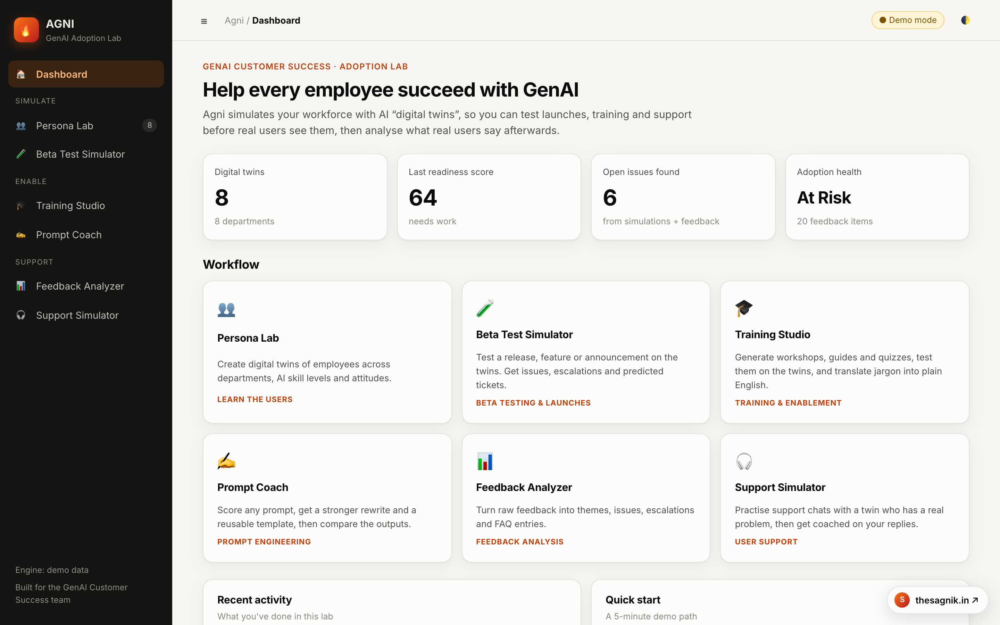
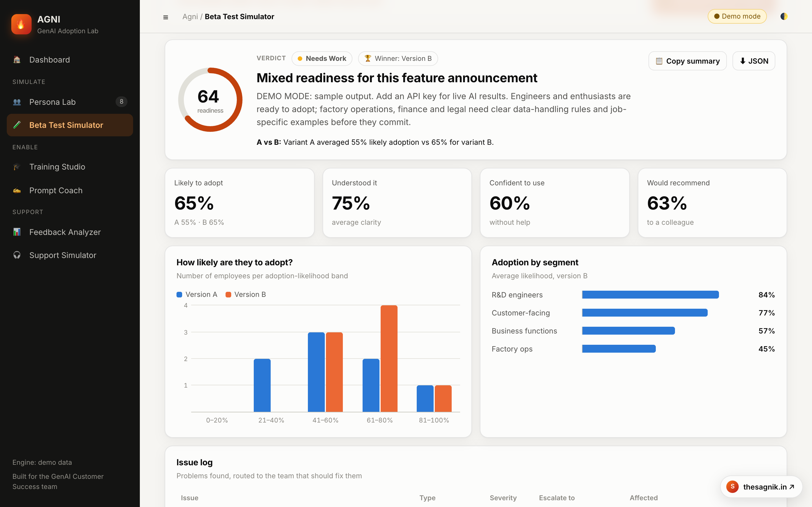
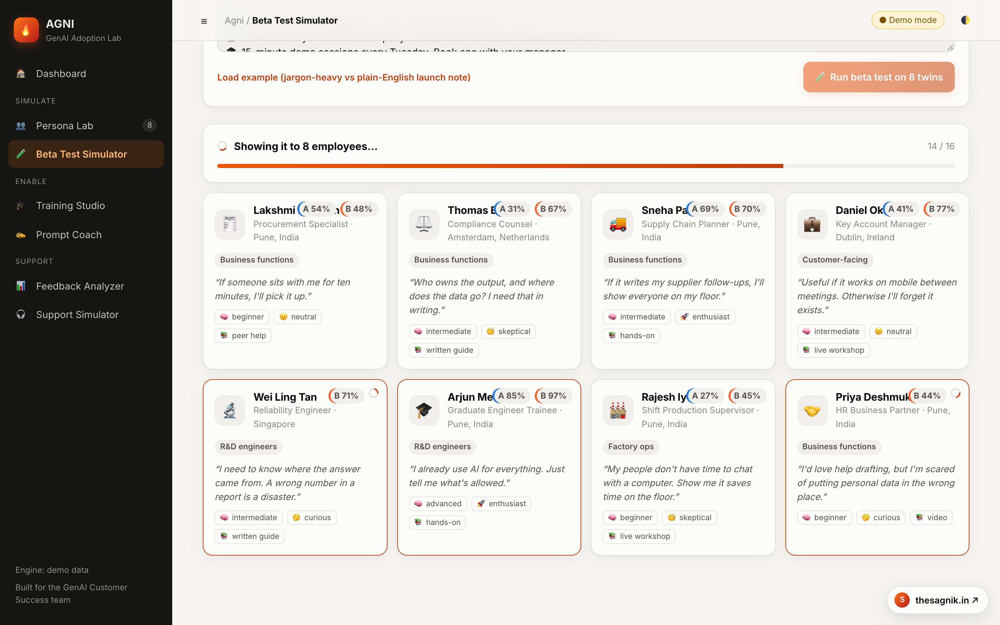
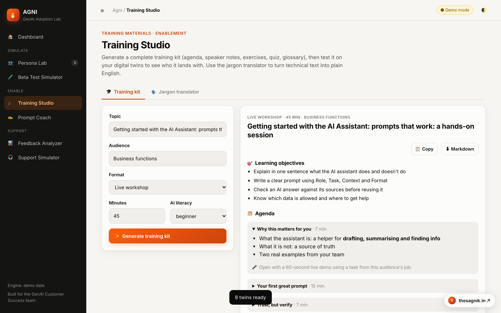
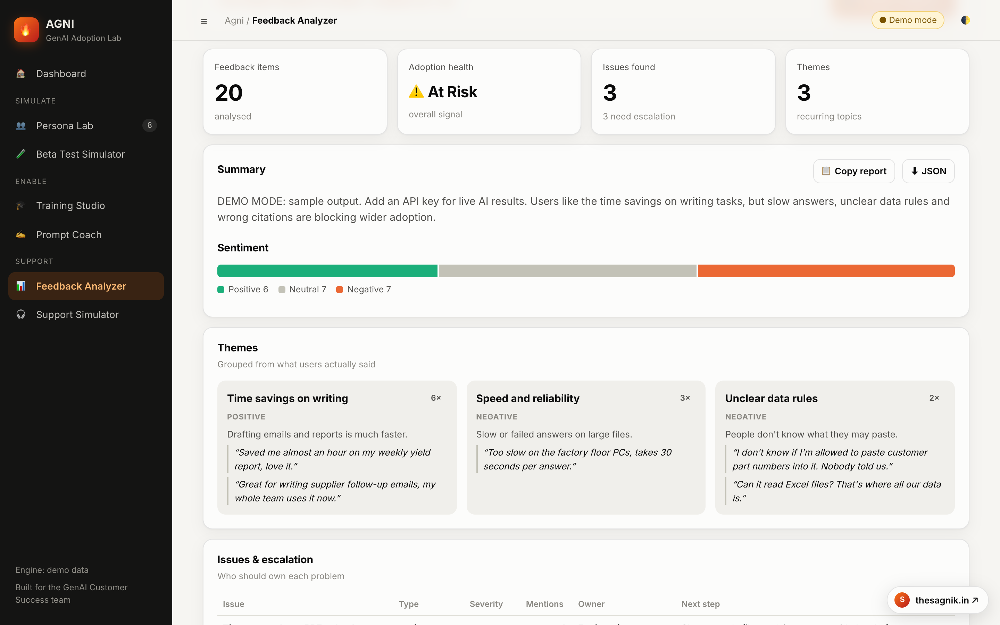
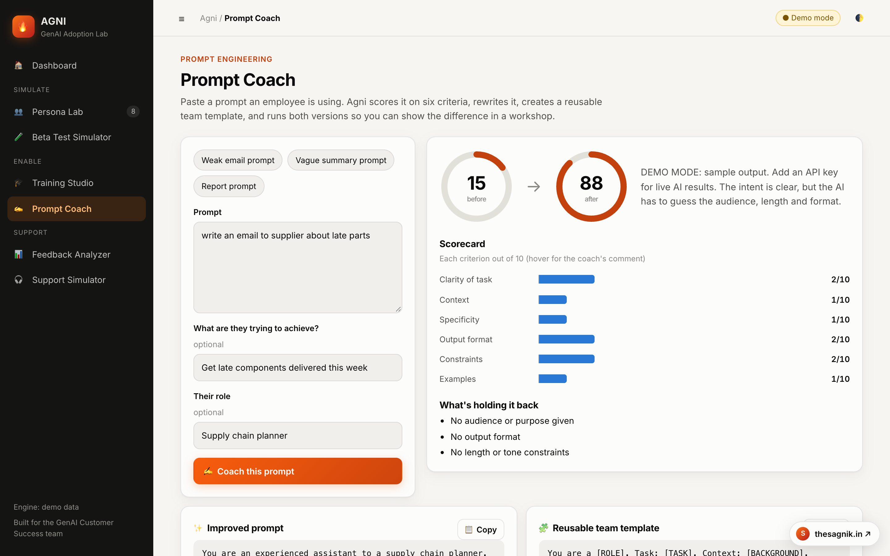
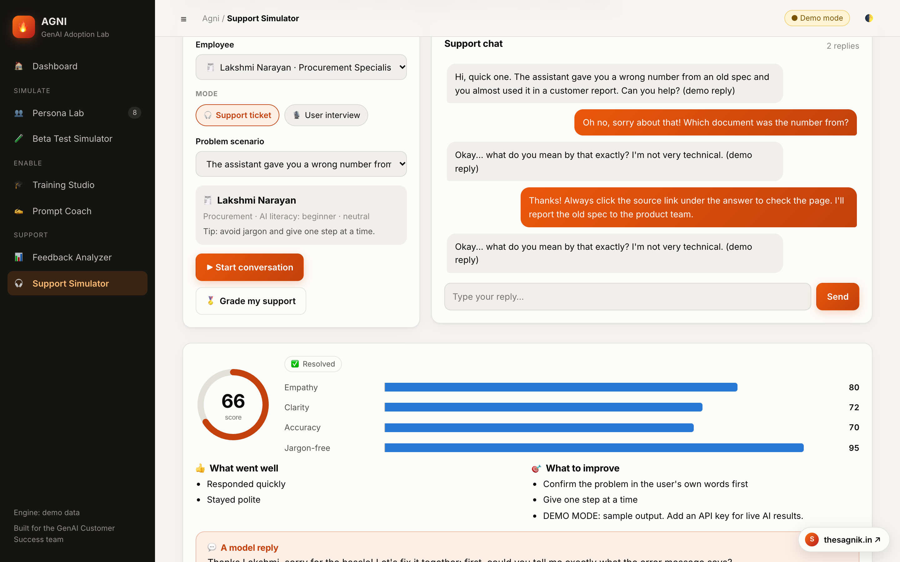
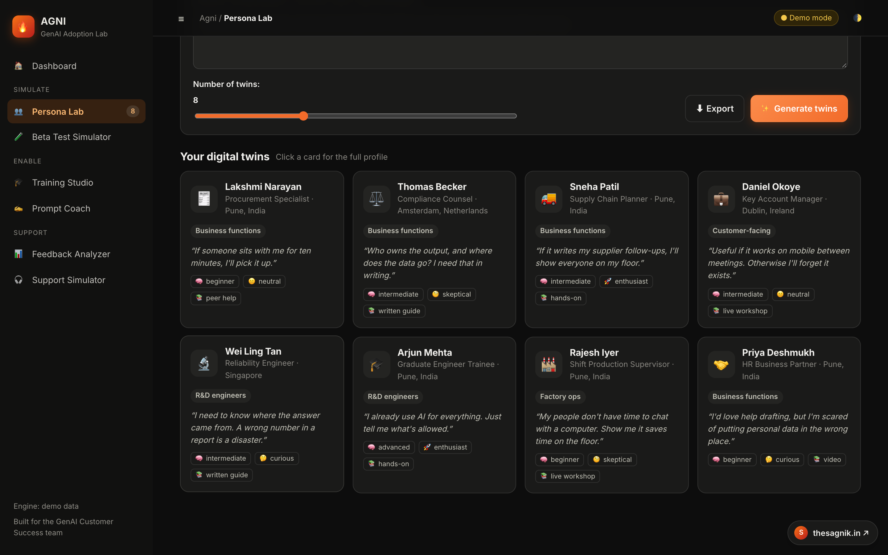

<div align="center">


# Agni: GenAI Adoption Lab

**Test AI rollouts on a simulated workforce before real employees ever see them.**




</div>

## The problem

Rolling out an internal AI assistant is easy. Getting **29,000 employees to actually use it well** is hard.

- Engineers worry about pasting confidential code.
- Factory supervisors have no time for a 2-hour workshop.
- Finance has watched tools get abandoned before.
- Legal wants to know where the data goes.

A GenAI Customer Success team has to beta test, train, support and listen to all of these people, usually
after launch, when mistakes are expensive.

## The idea

Agni builds **digital twins** of employees, each with a job, an AI-literacy level, an attitude toward AI and
real concerns. Every launch announcement, training session and support reply can be **rehearsed on the twins
first**. When real feedback arrives, Agni turns it into an action plan.

## Features

| | Module | What it does |
|---|---|---|
| 👥 | **Persona Lab** | Generates realistic employee twins across departments, skill levels and attitudes |
| 🧪 | **Beta Test Simulator** | Shows a release or announcement to every twin in parallel, with **A/B testing**. Returns a launch-readiness score, an **issue log routed to the right team**, and **predicted support tickets** with ready answers |
| 🎓 | **Training Studio** | Generates a full training kit (agenda, speaker notes, exercises, quiz, glossary), then **tests the kit on the twins**. Includes a jargon-to-plain-English translator |
| ✍️ | **Prompt Coach** | Scores a prompt on 6 criteria, rewrites it, creates a reusable team template, and **runs both versions side by side** |
| 📊 | **Feedback Analyzer** | Turns raw survey or chat feedback into themes, sentiment, escalations, adoption blockers, quick wins and FAQ drafts |
| 🎧 | **Support Simulator** | A twin brings you a real problem. Solve it, then get graded on **empathy, clarity, accuracy and jargon**. Also has a user-interview mode |

## Screenshots

**Beta test with A/B comparison: readiness, adoption by segment, issue log**


| Live simulation | Training Studio |
|---|---|
|  |  |

| Feedback Analyzer | Prompt Coach |
|---|---|
|  |  |

| Support Simulator | Dark mode |
|---|---|
|  |  |

## How it works

```
Browser (vanilla JS)  ──JSON / NDJSON stream──►  FastAPI
                                                   │
                         ┌─────────────────────────┴───────────────┐
                         ▼                                         ▼
                 services/ (live LLM)                     demo/ (offline engine)
                         │
                         ▼
                 core/llm.py → LLM API (structured outputs)
```

- **Structured outputs everywhere.** Every LLM call returns JSON validated against a Pydantic schema, so the UI never parses free text.
- **Parallel simulation.** A beta test runs one LLM call per twin per version (up to 32 at once), streaming each reaction to the browser as it arrives. A final call writes the readiness report.
- **Cost-aware reasoning.** Effort is tuned per task: low for twin reactions and chat, medium for generation, high for the analyst report.
- **Prompt caching.** Shared context is placed first so it is reused across twins.
- **Demo mode.** With no API key, a deterministic offline engine with the same interface powers the whole UI, so it runs anywhere.

More detail in [docs/ARCHITECTURE.md](docs/ARCHITECTURE.md).

## Getting started

```bash
git clone https://github.com/sagniksannigrahi/Agni-GenAI-Adoption-Lab-Digital-Twin-Employee-Simulator-.git
cd Agni-GenAI-Adoption-Lab-Digital-Twin-Employee-Simulator-
./run.sh
```

Open **http://localhost:8000**. It starts in demo mode.

For live AI results, copy `.env.example` to `.env`, add your API key, and restart.

<details>
<summary>Manual setup</summary>

```bash
python3 -m venv .venv
.venv/bin/pip install -r requirements.txt
.venv/bin/uvicorn backend.app.main:app --reload
```
</details>

### Run the tests

```bash
.venv/bin/pip install -r requirements-dev.txt
.venv/bin/python -m pytest -q
```

## Project structure

```
├── backend/app/
│   ├── main.py            # FastAPI app: routers + serves the frontend
│   ├── core/              # settings and the LLM client wrapper
│   ├── api/routes/        # one router per module
│   ├── schemas/           # Pydantic models (structured LLM outputs)
│   ├── prompts/           # all system prompts in one place
│   ├── services/          # LLM-powered logic per module
│   └── demo/              # offline demo engine + sample employees
├── frontend/
│   ├── index.html         # app shell
│   ├── css/               # design tokens, components, charts
│   └── js/                # API client, state, charts, one module per page
├── docs/                  # architecture notes and screenshots
└── tests/                 # end-to-end API tests
```

## Tech stack

**Backend:** Python, FastAPI, Pydantic, Anthropic SDK (LLM), async parallel requests, NDJSON streaming
**Frontend:** HTML, CSS (light/dark themes, responsive), vanilla JavaScript ES modules, custom charts
**Testing:** pytest with FastAPI TestClient

## Author

**Sagnik Sannigrahi** · [thesagnik.in](https://thesagnik.in) · sagniksannigrahi@gmail.com
